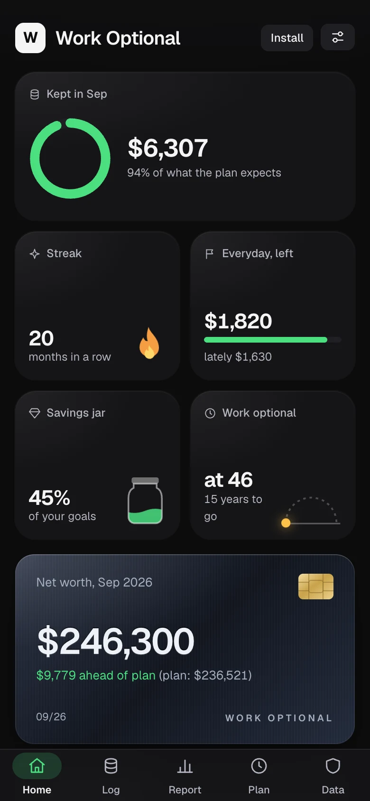
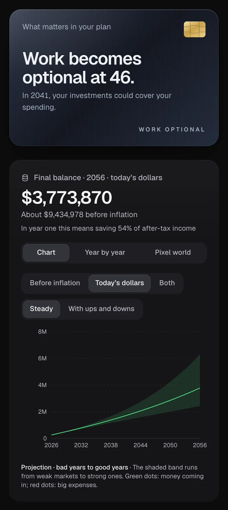
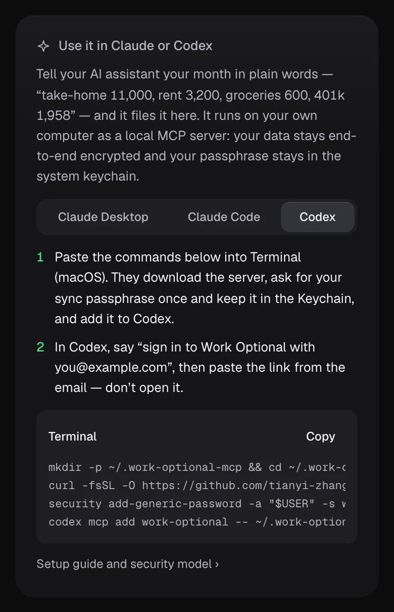
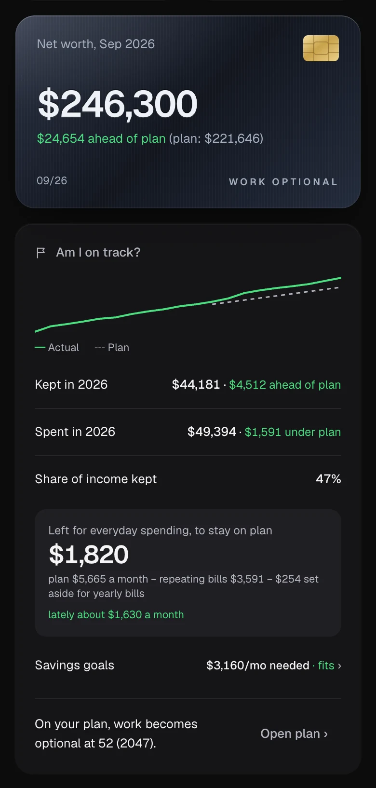
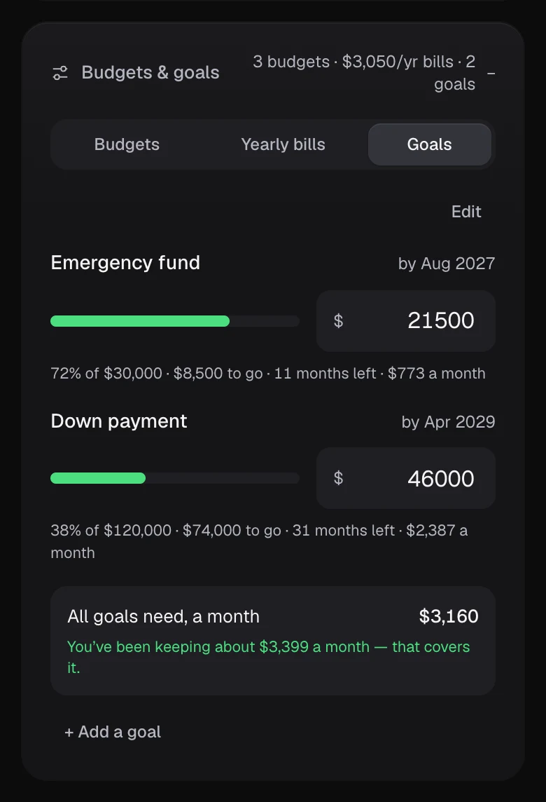
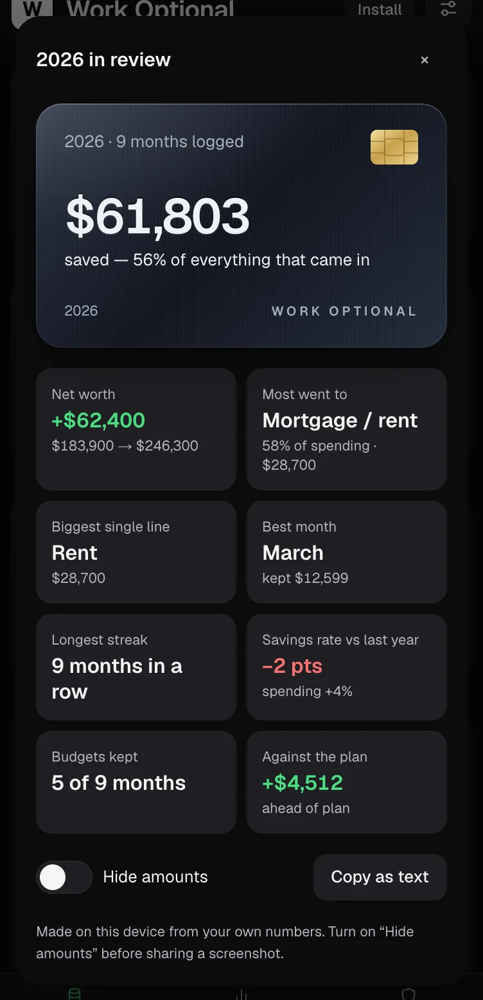
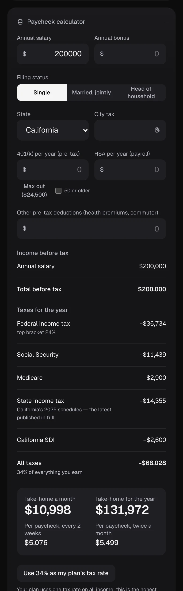
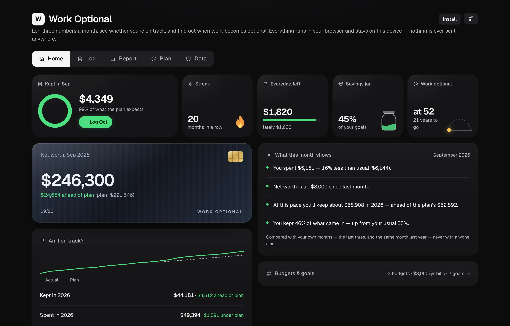

<p align="center">
  
</p>

<h1 align="center">Work Optional</h1>

<p align="center">
  <b>Log your money in a minute a month — and see the year work becomes optional.</b>
</p>

<p align="center">
  <a href="https://accretia.vercel.app/?demo"><b>▶ Try it live with sample data</b></a>
  &nbsp;·&nbsp; <a href="https://accretia.vercel.app">Open the app</a>
  &nbsp;·&nbsp; <b>English</b> · <a href="README.zh-CN.md">简体中文</a>
</p>

<p align="center">
  <a href="https://github.com/tianyi-zhang-02/accretia/releases"></a>
  <a href="LICENSE"></a>
</p>

A local-first money app: three numbers a month (money in, money out, net worth), a plan that tells you when work becomes optional, and a clear answer to _am I keeping up?_ It runs in your browser, installs as an offline app, and keeps your data on your device. The sample link opens a made-up household with 20 months logged — nothing you change is saved.

<table>
  <tr>
    <td align="center" width="33%">
      <picture>
        <source media="(prefers-color-scheme: light)" srcset="docs/media/en/track-light.webp">
        
      </picture>
      <br><b>Track</b><br>Log a month in 30 seconds and see what you kept.
    </td>
    <td align="center" width="33%">
      <picture>
        <source media="(prefers-color-scheme: light)" srcset="docs/media/en/plan-light.webp">
        
      </picture>
      <br><b>Plan</b><br>The year work becomes optional, in today's dollars.
    </td>
    <td align="center" width="33%">
      
      <br><b>Data</b><br>Yours: backups, encrypted sync, and your AI assistant.
    </td>
  </tr>
</table>

## A quick tour

<table>
  <tr>
    <td width="300"></td>
    <td>
      <h3>Log a month in 30 seconds</h3>
      <b>Same as last month</b> fills every blank from the month before — then you change only what's different. Bills that repeat are filled in and tagged. Money out can be one total, ten categories, or line items (rent, property tax, car insurance…); income can be split by source, and 401(k) / pre-tax savings count toward your savings rate.
    </td>
  </tr>
  <tr>
    <td>
      <picture>
        <source media="(prefers-color-scheme: light)" srcset="docs/media/en/on-track-light.webp">
        
      </picture>
    </td>
    <td>
      <h3>Am I on track?</h3>
      Your real net worth against where the plan said you'd be, the year so far, and <b>what's left for everyday spending</b>: the plan's monthly spending, minus the bills that repeat and a twelfth of the yearly ones. Below it, what this month shows compared with your own last three.
    </td>
  </tr>
  <tr>
    <td></td>
    <td>
      <h3>Budgets, yearly bills and savings goals</h3>
      A monthly limit per category (left / over as you log), once-a-year bills with what to set aside each month, and goals — an emergency fund, a down payment — with what each needs a month and whether they fit in what you've been keeping.
    </td>
  </tr>
  <tr>
    <td></td>
    <td>
      <h3>Year in review</h3>
      One card for your year: saved and at what rate, net worth, where the money went, best month, longest streak, against last year and the plan. <b>Hide amounts</b> turns every dollar into dots before you share a screenshot. Next to it, a printable year report.
    </td>
  </tr>
  <tr>
    <td>
      <picture>
        <source media="(prefers-color-scheme: light)" srcset="docs/media/en/plan-light.webp">
        
      </picture>
    </td>
    <td>
      <h3>The plan</h3>
      A year-by-year projection from your own assumptions — career income, spending, a home, windfalls — that answers <i>when does work become optional?</i> (Full, Lean and Coast FIRE), shown in today's dollars. Advanced tools add goal-seek, Monte Carlo and stress tests.
    </td>
  </tr>
  <tr>
    <td></td>
    <td>
      <h3>Paycheck calculator</h3>
      Salary and bonus → every tax laid out like a budget sheet → take-home per year, month and paycheck. Federal 2026, Social Security, Medicare, California, New York State and New York City are computed from the published tables; other states are an editable estimate. One tap puts the effective rate into your plan.
    </td>
  </tr>
  <tr>
    <td></td>
    <td>
      <h3>Use it in Claude or Codex</h3>
      A local MCP server for Claude Desktop, Claude Code and Codex: say <i>“take-home 11,000, rent 3,200, groceries 600”</i> and it's filed into your ledger. It runs on your own computer, keeps the data end-to-end encrypted, and with sync on it's just another device on your account. Ask for a year report or whether you're on track. Setup and security model: <a href="mcp/README.md"><code>mcp/README.md</code></a>.
    </td>
  </tr>
</table>

<p align="center">
  <picture>
    <source media="(prefers-color-scheme: light)" srcset="docs/media/en/desktop-light.webp">
    
  </picture>
</p>

Everything that changed, release by release: [`CHANGELOG.md`](CHANGELOG.md).

## Private by design

- **Local-first.** Your plan and ledger live in this browser's storage on your device; untick _Save on this device_ to keep them in memory only. _Back up everything_ saves one file you own.
- **Optional end-to-end-encrypted sync.** Encrypted on your device with a passphrase only you know; the server stores ciphertext. A one-time recovery code is the only other way in — there is deliberately no email reset. See [`docs/cloud-setup.md`](docs/cloud-setup.md).
- **No tracking.** No analytics, telemetry or cookies, and a strict Content-Security-Policy (`connect-src 'self'`). A test in CI fails if code adds a network call or storage beyond the approved ones.
- **Open source** under the MIT license — read every line.

## Install it as an app

It's a PWA: Data → _Use it as an app_ (Install in Chrome / Edge / Android, Share → Add to Home Screen on iPhone). It opens full-screen, works offline, and tells you when a new version is ready.

## Run it yourself

```bash
git clone https://github.com/tianyi-zhang-02/accretia.git
cd accretia
npm install
npm run dev     # → http://localhost:3000
```

Node 22 (see `.nvmrc`). No environment variables needed — sync stays off unless a deployment switches it on ([`docs/cloud-setup.md`](docs/cloud-setup.md)). Deploys anywhere that runs Next.js.

## For developers

| Command                              | What it does                                                                              |
| ------------------------------------ | ----------------------------------------------------------------------------------------- |
| `npm run dev`                        | Dev server on `localhost:3000`                                                            |
| `npm run build` / `npm run start`    | Production build / serve                                                                  |
| `npm run lint` / `npm run typecheck` | ESLint / TypeScript                                                                       |
| `npm test`                           | Vitest — engine, ledger, tax tables, crypto, the MCP server, and the isolation rules      |
| `npm run format`                     | Prettier                                                                                  |
| `npm run screenshots`                | Rebuild the README pictures and the hero animation from sample data (needs Google Chrome) |

**Stack:** Next.js 16 (App Router) · TypeScript · Tailwind v4 · Recharts · Zod. Runtime dependencies stop there, plus `@supabase/supabase-js`, loaded only when sync is switched on.

**How it fits together**

```
src/
  app/simulator-client.tsx   the one page: Track · Plan · Data, all UI state
  components/ledger/         check-in, on-track, budgets & goals, year report & review
  components/simulator/      plan summary, assumptions, paycheck calculator
  lib/simulator/             the engine — a pure function, simulate(assumptions) → year rows
  lib/ledger/                months, CSV, reports, budgets, goals, allowance (pure, tested)
  lib/tax/                   paycheck tax tables (hand-computed tests)
  lib/cloud/                 E2EE crypto + the only network module
  lib/i18n/                  English / 简体中文
mcp/                         the Claude / Codex extension (its own package)
```

The engine has no I/O; goal-seek (bisection), FIRE, Monte Carlo and stress tests all reuse it. `src/lib/isolation.test.ts` pins the privacy rules — no new network calls, storage keys, env vars or cookies — and runs in CI on every pull request.

## License

MIT — see [LICENSE](LICENSE).

> **Two names, on purpose.** The app is **Work Optional** — it's what it tells you. The repo and the site keep the original name **Accretia** (from _accretion_), because a US wealth-management firm already trades as Work Optional.
