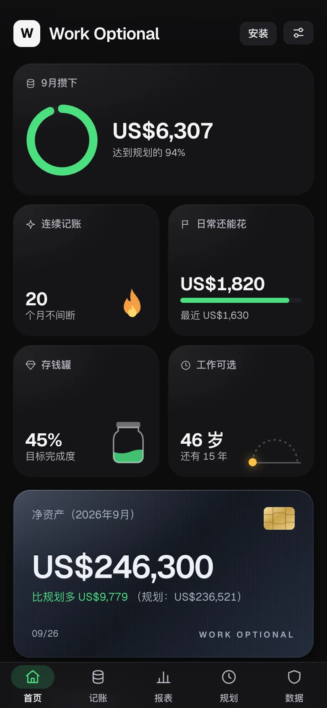
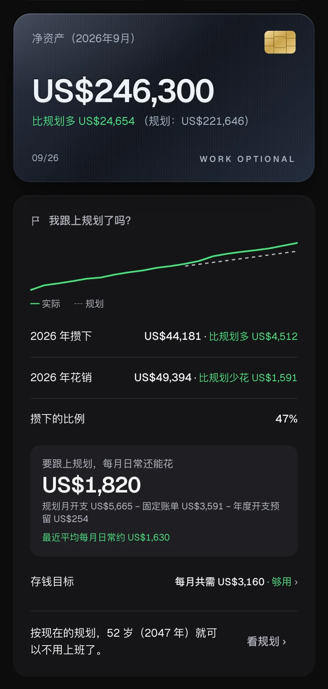
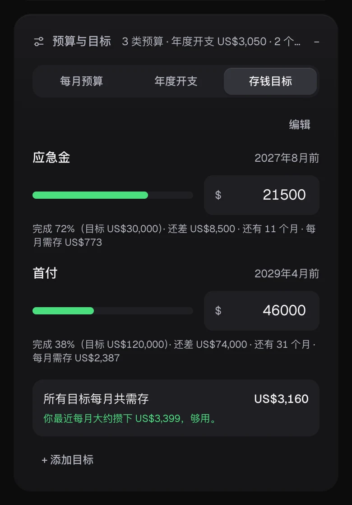
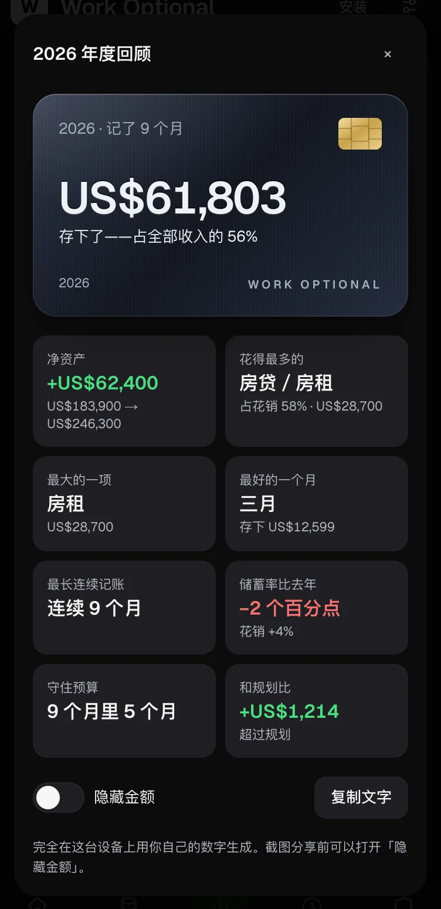
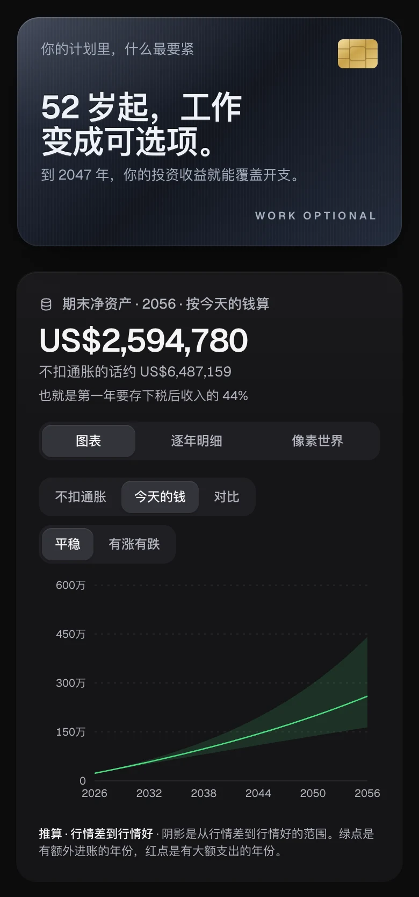
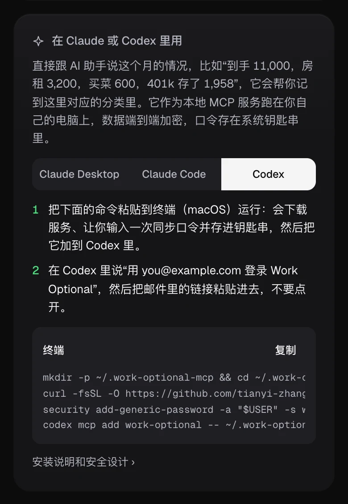

<p align="center">
  
</p>

<h1 align="center">Work Optional</h1>

<p align="center"><b>每月花一分钟记账，算出哪一年，工作变成可选。</b></p>

<p align="center">
  <a href="https://accretia.vercel.app/?demo&lang=zh"><b>▶ 用示例数据在线试试</b></a>
  &nbsp;·&nbsp; <a href="https://accretia.vercel.app/?lang=zh">打开应用</a>
  &nbsp;·&nbsp; <a href="README.md">English</a> · <b>简体中文</b>
</p>

<p align="center">
  <a href="https://github.com/tianyi-zhang-02/accretia/releases"></a>
  <a href="LICENSE"></a>
</p>

<table>
  <tr>
    <td align="center" width="33%"><br><b>一眼看全</b><br><sub>这个月、连续记账、存钱目标，点一下就记。</sub></td>
    <td align="center" width="33%"><br><b>我跟上规划了吗？</b><br><sub>净资产和规划比，日常还能花多少。</sub></td>
    <td align="center" width="33%"><br><b>预算与目标</b><br><sub>每类预算、年度开支、存钱目标。</sub></td>
  </tr>
  <tr>
    <td align="center"><br><b>年度回顾</b><br><sub>一张卡片看完一年，可隐藏金额分享。</sub></td>
    <td align="center"><br><b>规划</b><br><sub>哪一年工作变成可选，按今天的钱算。</sub></td>
    <td align="center"><br><b>Claude 与 Codex</b><br><sub>说一句“到手 11,000，房租 3,200”就记好。</sub></td>
  </tr>
</table>

另外还有：30 秒记完一个月（一键照上月填）、工资到手计算器（联邦、加州、纽约精确计算）、能装成离线可用的 app、中英双语。

## 隐私是设计出来的

- **本地优先**——数据留在你的浏览器里，一键备份成你自己保管的文件。
- **可选的端到端加密同步**——服务器只看得到密文；忘了口令用恢复码，故意不做邮箱重置。
- **不追踪、开源**——没有统计和 Cookie，内容安全策略严格；CI 里有测试，代码一旦加了未经批准的网络请求或存储就会失败。

## 开始用

**先试试：**[在线示例](https://accretia.vercel.app/?demo&lang=zh)——一个虚构的家庭，什么都不会保存。**长期用：**数据 →「当成 app 用」装到桌面（iPhone 用 分享 → 添加到主屏幕）。**自己运行：**

```bash
git clone https://github.com/tianyi-zhang-02/accretia.git && cd accretia && npm install && npm run dev
```

[Claude 与 Codex 安装说明](mcp/README.md) · [开发者指南](docs/development.md)（英文） · [更新日志](CHANGELOG.md)（英文） · [MIT 许可证](LICENSE)

<sub>应用叫 **Work Optional**；仓库和网站沿用原名 **Accretia**，因为美国已有一家财富管理公司以 Work Optional 经营。</sub>
