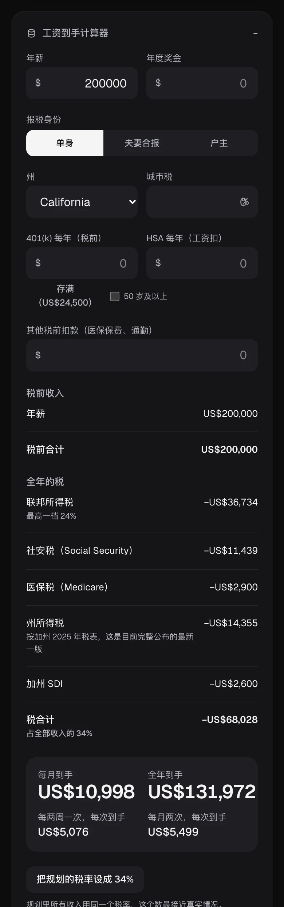
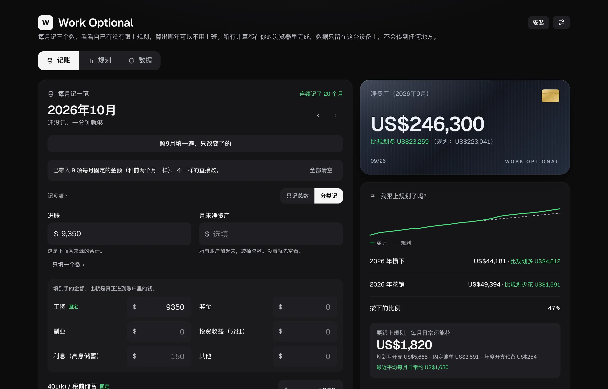

<p align="center">
  
</p>

<h1 align="center">Work Optional</h1>

<p align="center">
  <b>每月花一分钟记账，算出哪一年，工作变成可选。</b>
</p>

<p align="center">
  <a href="https://accretia.vercel.app/?demo&lang=zh"><b>▶ 用示例数据在线试试</b></a>
  &nbsp;·&nbsp; <a href="https://accretia.vercel.app/?lang=zh">打开应用</a>
  &nbsp;·&nbsp; <a href="README.md">English</a> · <b>简体中文</b>
</p>

<p align="center">
  <a href="https://github.com/tianyi-zhang-02/accretia/releases"></a>
  <a href="LICENSE"></a>
</p>

一个本地优先的记账应用：每月三个数（进账、花销、净资产），一份告诉你哪一年可以不再为钱上班的规划，再回答一个最实际的问题——_我跟上了吗？_ 它在浏览器里运行，能装成离线可用的 app，数据留在你自己的设备上。上面的示例链接会打开一个虚构的家庭，已经记了 20 个月——你怎么改都不会保存。

<table>
  <tr>
    <td align="center" width="33%">
      <picture>
        <source media="(prefers-color-scheme: light)" srcset="docs/media/zh/track-light.webp">
        
      </picture>
      <br><b>记账</b><br>30 秒记完一个月，当场看到攒下多少。
    </td>
    <td align="center" width="33%">
      <picture>
        <source media="(prefers-color-scheme: light)" srcset="docs/media/zh/plan-light.webp">
        
      </picture>
      <br><b>规划</b><br>哪一年工作变成可选，按今天的钱算。
    </td>
    <td align="center" width="33%">
      
      <br><b>数据</b><br>归你所有：备份、加密同步，还能交给 AI 助手。
    </td>
  </tr>
</table>

## 快速看一遍

<table>
  <tr>
    <td width="300"></td>
    <td>
      <h3>30 秒记完一个月</h3>
      新的一个月点一下<b>「照上个月填一遍」</b>，空着的地方全按上个月填好，你只改变了的那几项。每月固定的账单会自动带入并标上「固定」。花销可以只记总数、分十类，或者拆到小项（房租、房产税、车险……）；进账可以按来源拆开，401(k) 等税前储蓄也算进储蓄率。
    </td>
  </tr>
  <tr>
    <td>
      <picture>
        <source media="(prefers-color-scheme: light)" srcset="docs/media/zh/on-track-light.webp">
        
      </picture>
    </td>
    <td>
      <h3>我跟上规划了吗？</h3>
      真实净资产和规划里这个月该有的数放在一起，今年到目前为止攒了多少、花了多少，还有<b>每月日常还能花多少</b>：规划的月开支，减去每月固定的账单和年度开支的十二分之一。下面是「这个月的发现」——只和你自己最近三个月比。
    </td>
  </tr>
  <tr>
    <td></td>
    <td>
      <h3>预算、年度开支和存钱目标</h3>
      每类花销一个月度上限，记账时直接显示还剩多少、超了多少；一年一次的大额开支，算好每月该预留多少；应急金、首付这样的目标，看每个每月要存多少，以及你最近攒下的钱够不够。
    </td>
  </tr>
  <tr>
    <td></td>
    <td>
      <h3>年度回顾</h3>
      一张卡片看完一整年：存了多少、储蓄率、净资产变化、钱主要花在哪、最好的一个月、最长连续记账，再和去年、和规划比一比。分享截图前打开<b>「隐藏金额」</b>，所有金额都变成圆点。另有一份可打印的年度报表。
    </td>
  </tr>
  <tr>
    <td>
      <picture>
        <source media="(prefers-color-scheme: light)" srcset="docs/media/zh/plan-light.webp">
        
      </picture>
    </td>
    <td>
      <h3>规划</h3>
      根据你自己的假设——职业收入、开支、买房、额外收入——逐年推算，回答<i>哪一年工作变成可选？</i>（完全 / 精简 / Coast FIRE），默认按今天的钱显示。高级工具里还有目标求解、蒙特卡洛和压力测试。
    </td>
  </tr>
  <tr>
    <td></td>
    <td>
      <h3>工资到手计算器</h3>
      年薪加奖金，像预算表一样逐项列出每一种税，算出每年、每月、每次发薪到手多少。联邦 2026、社安税、医保税、加州、纽约州和纽约市按官方税表精确计算；其他州是可以修改的估算。一键把综合税率填进规划。
    </td>
  </tr>
  <tr>
    <td></td>
    <td>
      <h3>在 Claude 或 Codex 里用</h3>
      给 Claude Desktop、Claude Code 和 Codex 用的本地 MCP 服务：说一句<i>“到手 11,000，房租 3,200，买菜 600”</i>，就记进账本。它跑在你自己的电脑上，数据端到端加密；开了同步，它就是你账户里的另一台设备。也可以让它出年度报表，或者问问有没有跟上规划。安装和安全设计见 <a href="mcp/README.md"><code>mcp/README.md</code></a>。
    </td>
  </tr>
</table>

<p align="center">
  <picture>
    <source media="(prefers-color-scheme: light)" srcset="docs/media/zh/desktop-light.webp">
    
  </picture>
</p>

每个版本改了什么，见 [`CHANGELOG.md`](CHANGELOG.md)（英文）。

## 隐私是设计出来的

- **本地优先。** 规划和账本存在这个浏览器的本地存储里，只在你的设备上；取消勾选「在本设备保存」就只放在内存里。「备份全部数据」会给你一个自己保管的文件。
- **可选的端到端加密同步。** 数据先在你的设备上用只有你知道的口令加密，服务器只存读不了的密文。设口令时给你一串一次性的恢复码，是唯一的另一条路——故意不做邮箱重置。见 [`docs/cloud-setup.md`](docs/cloud-setup.md)。
- **不追踪。** 没有统计、遥测和 Cookie，内容安全策略严格（`connect-src 'self'`）。CI 里有一个测试，代码一旦加了未经批准的网络请求或存储就会失败。
- **开源**，MIT 许可证，每一行都可以看。

## 装成 app

它是一个 PWA：数据 → 「当成 app 用」（Chrome / Edge / 安卓直接安装，iPhone 用 分享 → 添加到主屏幕）。全屏打开、离线可用，有新版本时会提醒你。

## 自己运行

```bash
git clone https://github.com/tianyi-zhang-02/accretia.git
cd accretia
npm install
npm run dev     # → http://localhost:3000
```

需要 Node 22（见 `.nvmrc`）。不需要任何环境变量——除非部署方主动打开，同步一直是关的（见 [`docs/cloud-setup.md`](docs/cloud-setup.md)）。任何能跑 Next.js 的地方都能部署。

## 给开发者

| 命令                                 | 作用                                                         |
| ------------------------------------ | ------------------------------------------------------------ |
| `npm run dev`                        | 在 `localhost:3000` 启动开发服务器                           |
| `npm run build` / `npm run start`    | 生产构建 / 启动                                              |
| `npm run lint` / `npm run typecheck` | ESLint / TypeScript 检查                                     |
| `npm test`                           | Vitest——引擎、账本、税表、加密、MCP 服务，以及隔离规则       |
| `npm run format`                     | Prettier                                                     |
| `npm run screenshots`                | 用示例数据重新生成 README 的截图和动图（需要 Google Chrome） |

**技术栈：** Next.js 16（App Router）· TypeScript · Tailwind v4 · Recharts · Zod。运行时依赖就这些，外加只在开启同步时才加载的 `@supabase/supabase-js`。

**结构一览**

```
src/
  app/simulator-client.tsx   唯一的页面：记账 · 规划 · 数据，全部 UI 状态
  components/ledger/         记账、是否跟上、预算与目标、年度报表与回顾
  components/simulator/      规划摘要、假设、工资到手计算器
  lib/simulator/             引擎——纯函数 simulate(assumptions) → 逐年数据
  lib/ledger/                月份、CSV、报表、预算、目标、日常额度（纯函数，有测试）
  lib/tax/                   工资税表（手算核对的测试）
  lib/cloud/                 端到端加密 + 唯一的联网模块
  lib/i18n/                  English / 简体中文
mcp/                         Claude / Codex 扩展（独立的包）
```

引擎没有任何 I/O；目标求解（二分法）、FIRE、蒙特卡洛和压力测试都复用它。`src/lib/isolation.test.ts` 把隐私规则钉死——不许新增网络请求、存储键、环境变量或 Cookie——每个 PR 都在 CI 里跑。

## 许可证

MIT——见 [LICENSE](LICENSE)。

> **两个名字是故意的。** 应用叫 **Work Optional**——这正是它告诉你的那句话。仓库和网站沿用原名 **Accretia**（源自 _accretion_，靠累积而增长），因为美国已有一家财富管理公司以 Work Optional 经营。
